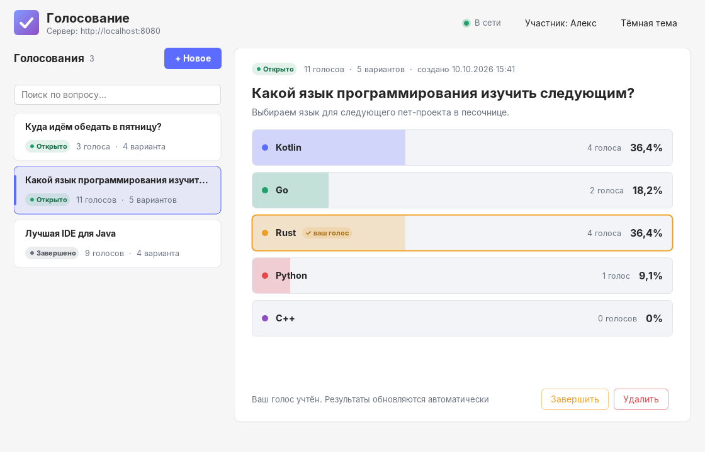
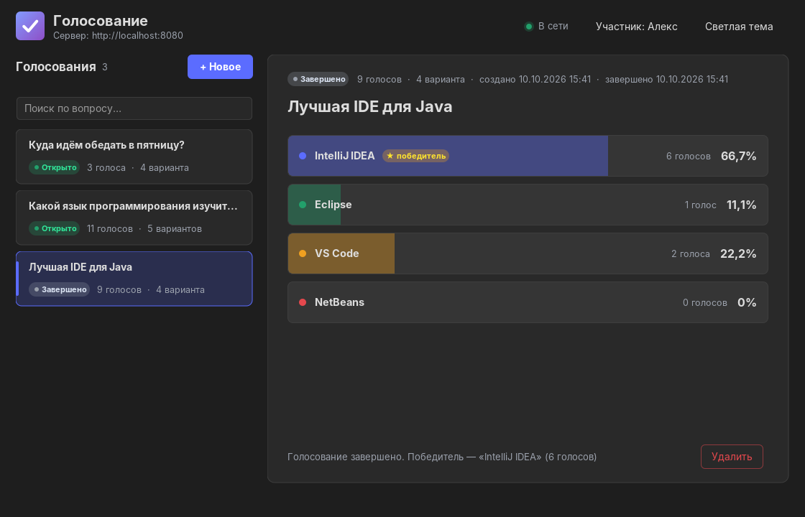
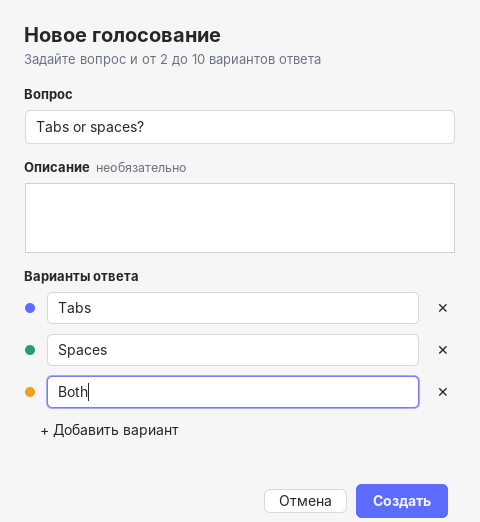

# 🗳️ Voting

**Клиент-серверное приложение для голосований**

> Сервер на **Spring Boot** хранит голосования и считает голоса, а настольный клиент на **Spring Boot + Swing**
> показывает результаты в реальном времени: несколько клиентов голосуют одновременно, и каждый видит, как меняются
> проценты.




---

## 📖 Содержание

- [О проекте](#-о-проекте)
- [Зачем это нужно](#-зачем-это-нужно)
- [Возможности](#-возможности)
- [Технологический стек](#-технологический-стек)
- [Структура модуля](#-структура-модуля)
- [Сервер: REST API](#-сервер-rest-api)
- [Клиент: интерфейс](#-клиент-интерфейс)
- [Конфигурация](#-конфигурация)
- [Быстрый старт](#-быстрый-старт)
- [База данных](#-база-данных)
- [Возможные улучшения в будущем](#-возможные-улучшения-в-будущем)

---

## 🎯 О проекте

**Voting** — модуль песочницы [Sandbox](../README.md), состоящий из двух независимых приложений и общей библиотеки:

1. **Server** — REST API: создать голосование, проголосовать, посмотреть результаты, завершить, удалить.
2. **Client** — настольное приложение: список голосований, результаты с анимированными полосами, голосование в один
   клик, создание новых голосований, светлая и тёмная тема.
3. **Common** — DTO (Java `record`), которые используют и сервер, и клиент, поэтому формат обмена описан один раз.

Правила простые: в голосовании от 2 до 10 вариантов, **один участник — один голос**, в завершённом голосовании
голосовать нельзя.

## 💡 Зачем это нужно

Учебный проект для практики связки «сервер + клиент» на Java:

- поднять **REST-сервер** на Spring Boot: контроллеры, валидация (`jakarta.validation`), единый формат ошибок через
  `@RestControllerAdvice`, корректные HTTP-статусы (`201`, `204`, `400`, `404`, `409`);
- использовать **Spring Boot без веб-сервера** (`WebApplicationType.NONE`) — как каркас настольного приложения с DI,
  конфигурацией из `application.yaml` и `RestClient`;
- вынести общие **DTO** в отдельный Maven-модуль;
- сделать **красивый Swing**: FlatLaf, собственная отрисовка через `Graphics2D`, анимации, тёмная тема;
- выполнять сетевые запросы в фоне (`SwingWorker`), не замораживая интерфейс, и периодически опрашивать сервер;
- хранить данные через **Spring Data JPA** во временной базе **H2**: entity, связи, проекции, блокировки.

## ✨ Возможности

### 🖥️ Сервер

- Хранение во временной базе **H2** (в памяти) через **JPA**; голоса считаются запросами к базе.
- Один голос гарантирован дважды: проверкой в сервисе и уникальным индексом `(poll_id, voter)`; голоса и
  завершение одного голосования идут по очереди благодаря блокировке строки (`PESSIMISTIC_WRITE`).
- Один голос на участника: имена сравниваются без учёта регистра и пробелов по краям.
- Проценты с округлением до десятых, сортировка: сначала открытые голосования, внутри — от новых к старым.
- Валидация запросов с понятными сообщениями (на русском при заголовке `Accept-Language: ru`).
- Демонстрационные голосования при старте (отключаются настройкой).

### 🎨 Клиент

- Список голосований-карточек с поиском, статусом и количеством голосов.
- Результаты в виде цветных полос с плавной анимацией; клик по варианту — голос.
- Пометки «✓ ваш голос» и «★ победитель», подсказки о состоянии голосования.
- Автообновление каждые 3 секунды — голоса других участников появляются сами.
- Создание голосования в диалоге: варианты добавляются по Enter, проверка ещё до отправки на сервер.
- Завершение и удаление голосования с подтверждением.
- Индикатор соединения с сервером и строка статуса с результатом последнего действия.
- Светлая и тёмная тема, переключение на лету.

| Тёмная тема                    | Новое голосование                         |
|--------------------------------|-------------------------------------------|
|  |  |

## 🛠️ Технологический стек

| Технология                   | Где               | Назначение                                        |
|------------------------------|-------------------|---------------------------------------------------|
| **Java 25**                  | везде             | Язык (`record`, pattern matching, text blocks)    |
| **Spring Boot 4.1** Web MVC  | Server            | REST-контроллеры, встроенный Tomcat               |
| **Jakarta Validation**       | Server, Common    | Валидация входящих DTO                            |
| **Spring Boot** RestClient   | Client            | HTTP-запросы к серверу, Jackson 3 для JSON        |
| **Swing** + **FlatLaf 3.7**  | Client            | Интерфейс, современный Look & Feel (macOS-темы)   |
| **Lombok**                   | везде             | `@Builder`, `@RequiredArgsConstructor`, `@Slf4j`  |
| **Spring Data JPA** (Hibernate 7) | Server       | Entity, репозитории, транзакции                   |
| **H2**                       | Server            | Временная база в памяти + веб-консоль             |

## 📁 Структура модуля

```text
Voting/                                   a.slelin.work.sandbox:voting           (pom)
├── pom.xml                               версии Spring Boot и FlatLaf, общий spring-boot-maven-plugin
├── Common/                               a.slelin.work.sandbox.voting:common
│   └── .../voting/common/dto/            PollCreateRequest, VoteRequest, PollResponse, PollSummaryResponse,
│                                         OptionResponse, PollStatus, ErrorResponse
├── Server/                               a.slelin.work.sandbox.voting:server    → Server.jar
│   └── .../voting/server/
│       ├── VotingServer.java             точка входа
│       ├── controller/                   PollController, GlobalExceptionHandler
│       ├── service/                      PollService (бизнес-логика), PollMapper (модель → DTO)
│       ├── entity/                       Poll, PollOption, Vote (JPA entity)
│       ├── repository/                   PollRepository, VoteRepository (Spring Data JPA)
│       ├── exception/                    VotingException и наследники со своим HTTP-статусом
│       └── config/                       DemoDataLoader
└── Client/                               a.slelin.work.sandbox.voting:client    → Client.jar
    └── .../voting/client/
        ├── VotingClient.java             точка входа (Spring Boot без веб-сервера)
        ├── config/                       ClientProperties, RestClientConfig
        ├── api/                          VotingApi (обёртка над REST), ApiException
        └── ui/                           MainFrame, HeaderPanel, PollListPanel, PollDetailsPanel, OptionBar,
                                          CreatePollDialog, StatusBar, Theme, …
```

```text
┌─────────────── Client ───────────────┐            ┌──────────────── Server ────────────────┐
│ Swing UI ─► VotingApi ─► RestClient ─┼── HTTP ───►│ PollController ─► PollService          │
│     ▲            (SwingWorker)       │   JSON     │        │          └─► Repositories ─► H2│
│     └──── Timer: обновление 3 c ─────┤◄───────────┤ GlobalExceptionHandler → ErrorResponse │
└──────────────────────────────────────┘            └────────────────────────────────────────┘
                     └──────────── общие DTO из Common ────────────┘
```

## 🗃️ База данных

Сервер хранит данные во **временной базе H2 в памяти** (`jdbc:h2:mem:voting`): схема создаётся из entity при старте
(`ddl-auto: create-drop`) и исчезает при остановке сервера.

```text
polls                       poll_options                 votes
├── id          UUID  PK    ├── id        BIGINT PK      ├── id         BIGINT PK
├── question                ├── poll_id   → polls        ├── poll_id    → polls      ┐ уникальная
├── description             ├── position                 ├── voter                   ┘ пара
├── status      OPEN/CLOSED └── text                     ├── option_id  → poll_options
├── created_at                                           └── voted_at
└── closed_at
```

| Entity       | Что хранит                                                                                       |
|--------------|--------------------------------------------------------------------------------------------------|
| `Poll`       | Вопрос, описание, статус, даты. Варианты — `@OneToMany` с каскадом; счётчики вариантов и голосов — `@Formula`, поэтому список голосований строится одним запросом |
| `PollOption` | Текст варианта и его позиция (`@OrderBy("position")`). `id` варианта — это `optionId` в API      |
| `Vote`       | Кто (имя в нижнем регистре), за какой вариант и когда проголосовал                               |

Посмотреть таблицы можно в веб-консоли: **http://localhost:8080/h2-console**
(JDBC URL `jdbc:h2:mem:voting`, пользователь `sa`, пароль пустой).

## 🔌 Сервер: REST API

Базовый адрес: `http://localhost:8080`.

| Метод    | URL                            | Тело / параметры                 | Ответ                                    |
|----------|--------------------------------|----------------------------------|------------------------------------------|
| `GET`    | `/api/polls`                   | —                                | `200` список `PollSummaryResponse`       |
| `GET`    | `/api/polls/{id}`              | `?voter=Имя` (необязательно)     | `200` `PollResponse`, `404`              |
| `POST`   | `/api/polls`                   | `PollCreateRequest`              | `201` `PollResponse` + `Location`, `400` |
| `POST`   | `/api/polls/{id}/votes`        | `VoteRequest`                    | `200` `PollResponse`, `404`, `409`       |
| `POST`   | `/api/polls/{id}/close`        | `?voter=Имя` (необязательно)     | `200` `PollResponse`, `404`              |
| `DELETE` | `/api/polls/{id}`              | —                                | `204`, `404`                             |

Если передан `voter`, в ответе заполняется `votedOptionId` — за какой вариант уже проголосовал этот участник.

**Пример: создать голосование**

```shell
curl -X POST http://localhost:8080/api/polls \
     -H "Content-Type: application/json" \
     -d '{"question": "Tabs or spaces?", "description": "Вечный спор", "options": ["Tabs", "Spaces"]}'
```

```json
{
  "id": "2b9f7228-11e1-438e-bc87-7e01c4f27fca",
  "question": "Tabs or spaces?",
  "description": "Вечный спор",
  "status": "OPEN",
  "options": [
    { "id": 1, "text": "Tabs",   "votes": 0, "percent": 0.0 },
    { "id": 2, "text": "Spaces", "votes": 0, "percent": 0.0 }
  ],
  "totalVotes": 0,
  "createdAt": "2026-10-10T15:26:50.924Z",
  "closedAt": null,
  "votedOptionId": null
}
```

**Пример: проголосовать**

```shell
curl -X POST http://localhost:8080/api/polls/{id}/votes \
     -H "Content-Type: application/json" \
     -d '{"voter": "Алекс", "optionId": 2}'
```

**Формат ошибки** — одинаковый для всех ошибок:

```json
{
  "status": 409,
  "error": "Conflict",
  "message": "Участник «Алекс» уже проголосовал в голосовании 2b9f7228-…",
  "path": "/api/polls/2b9f7228-…/votes",
  "details": null,
  "timestamp": "2026-10-10T15:26:50.772Z"
}
```

При ошибках валидации в `details` перечислены поля и причины, например
`{"question": "не должно быть пустым", "options": "размер должен находиться в диапазоне от 2 до 10"}`.

## 🎨 Клиент: интерфейс

- **Шапка** — логотип, адрес сервера, индикатор «В сети / Нет связи», текущий участник (клик — сменить) и
  переключатель темы.
- **Слева** — поиск и карточки голосований; выбранная карточка подсвечивается акцентным цветом.
- **Справа** — выбранное голосование: статус, количество голосов, даты, вопрос, описание и полосы вариантов.
  Полосы рисуются вручную (`OptionBar`, `Graphics2D`) и плавно «доезжают» до нового процента по таймеру.
- **Снизу** — строка статуса: «Голос за «Rust» учтён», ошибки сервера и т.д.

Все запросы выполняются через `SwingWorker` (класс `Async`), а `javax.swing.Timer` раз в несколько секунд обновляет
список и выбранное голосование. При обновлении того же голосования полосы не пересоздаются, а анимируются к новым
значениям.

## ⚙️ Конфигурация

**Сервер** — `Server/src/main/resources/application.yaml`:

| Свойство            | По умолчанию | Описание                                  |
|---------------------|--------------|-------------------------------------------|
| `server.port`       | `8080`       | Порт сервера                              |
| `voting.demo-data`  | `true`       | Создавать демонстрационные голосования    |
| `spring.datasource.url` | `jdbc:h2:mem:voting` | Адрес временной базы H2           |
| `spring.h2.console.enabled` | `true` | Веб-консоль базы на `/h2-console`        |

**Клиент** — `Client/src/main/resources/application.yaml`:

| Свойство                         | По умолчанию            | Описание                                      |
|----------------------------------|-------------------------|-----------------------------------------------|
| `voting.client.server-url`       | `http://localhost:8080` | Адрес сервера                                 |
| `voting.client.voter`            | пусто                   | Имя участника; если пусто — спросит при старте |
| `voting.client.refresh-interval` | `3s`                    | Период автообновления                         |
| `voting.client.dark-theme`       | `false`                 | Запускаться в тёмной теме                     |

Любое свойство можно переопределить при запуске: `--voting.client.voter=Алекс`.

## 🚀 Быстрый старт

```shell
# Из корня песочницы собираем модуль вместе с зависимостями;
mvn clean install -pl Voting -amd -am;

# Запускаем сервер (окно терминала №1);
java -jar Voting/Server/target/Server.jar;

# Запускаем клиента (окно терминала №2);
java -jar Voting/Client/target/Client.jar;

# Второй клиент под другим именем — чтобы посмотреть, как результаты обновляются у обоих;
java -jar Voting/Client/target/Client.jar --voting.client.voter=Борис;
```

Из **IDEA** — запустить `VotingServer`, затем `VotingClient` (для нескольких клиентов включить
*Allow multiple instances* в конфигурации запуска).

## 🔮 Возможные улучшения в будущем

- Постоянная база (PostgreSQL) и миграции схемы через Liquibase вместо `ddl-auto`.
- Push-обновления через **WebSocket / SSE** вместо периодического опроса.
- Несколько вариантов в одном голосе, анонимные голосования, дедлайн автозавершения.
- Авторизация: завершать и удалять голосование может только его автор.
- Экспорт результатов в CSV и диаграмма-«пончик» в клиенте.
